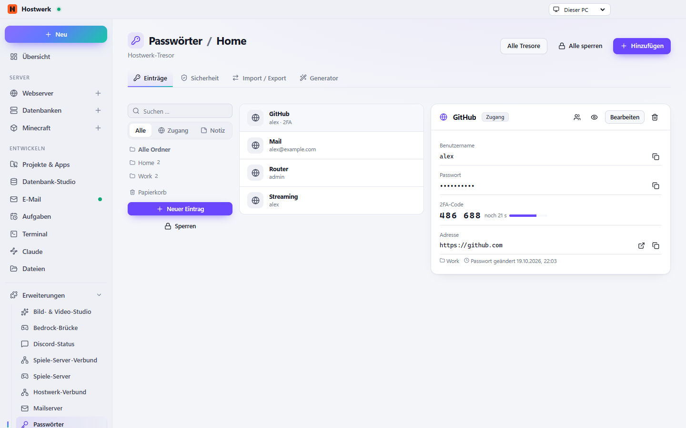

# Passwort-Manager

Eigener verschlüsselter Tresor auf diesem PC oder die Anbindung an den Passwort-Manager, den du schon nutzt – Bitwarden/Vaultwarden, 1Password, KeePass, pass oder LastPass. Alles andere (Google, Apple, Proton, Dashlane …) kommt per Import.

[English](README.md) · Offizielle [Hostwerk](https://github.com/Passimoritz/hostwerk-public)-Erweiterung (SDK 2.7, native Erweiterung)



## Was sie kann

- Hostwerk-Tresor (Format 3): ein zufälliger Tresor-Schlüssel verschlüsselt alles mit AES-256-GCM, das Master-Passwort (Argon2id, 64 MiB) schützt nur diesen Schlüssel – ein neues Master-Passwort muss Anhänge nie neu verschlüsseln; ältere Tresore werden beim Entsperren still angehoben; jedes Schreiben ist atomar. Sperrt sich nach Leerlauf selbst
- Drei Spalten wie in einem richtigen Passwort-Manager: Navigation (Alle, Favoriten, Zugänge, Notizen, Karten, Identitäten, SSH-Schlüssel, Passkeys, Dateien, Ordner, Schlagwörter, Papierkorb), Liste mit Webseiten-Symbolen (lokal zwischengespeichert) und Stärke-Punkt, Detail mit Kopierknöpfen. Tastatur: Strg+F, ↑/↓, Strg+C (Passwort), Strg+Umschalt+C (Benutzer)
- 2FA-Codes (TOTP) mit Ablaufring – den QR-Code liest Hostwerk aus einem Bild oder der Zwischenablage
- SSH-Schlüssel (ed25519 erzeugen oder einfügen, öffentlicher Teil + Fingerabdruck, Übergabe an Hostwerks SSH-Schlüssel), Passkeys (bleiben erhalten, werden angezeigt und nach Bitwarden und KeePassXC exportiert), verschlüsselte Anhänge (5 MB je Datei, 50 MB je Tresor), eigene Felder, Passwort-Verlauf
- Generator für Zeichen oder Passphrasen, mit **Regeln je Seite** (nutzt auch die Browser-Erweiterung); die Zwischenablage leert sich nach einer Zeit, die du festlegst
- Sicherheitsbericht: schwache, mehrfach genutzte, alte und geleakte Passwörter (Have I Been Pwned mit k-Anonymität, abschaltbar) und wichtige Dienste ohne 2FA – auch als Kachel „Passwort-Prüfung“ in der Übersicht
- Import: CSV/JSON aller gängigen Dienste, **KeePass .kdbx und XML**, **1Password .1pux**, **Bitwarden-JSON mit Passwort**, Enpass-JSON, jede CSV mit eigener Spaltenzuordnung – mit Vorschau und Duplikat-Erkennung
- Export verschlüsselt (KeePass .kdbx, Bitwarden-JSON mit Passwort); unverschlüsselt nur nach deutlicher Warnung. Kopieren zwischen Tresoren
- Tägliche verschlüsselte Sicherung (14 Stände) in Hostwerks Sicherungs-Zentrale, samt Zurückholen
- Eigene Bilder je Eintrag (Hostwerk-Tresor verschlüsselt, KeePass als eigene Symbole) – in Liste, Detail und Browser-Erweiterung; Bitwarden/1Password/pass/LastPass behalten das Webseiten-Symbol
- Browser-Erweiterung für Chrome, Edge, Firefox, Brave, Opera und Vivaldi – koppelt sich selbst, Vorschläge direkt im Anmeldefeld
  - bleibt ohne Hilfe verbunden: nach Hostwerk-Neustart, Port-Wechsel oder Update koppelt sie sich mit der Datei in ihrem Ordner neu; das Popup nennt die echte Ursache (Hostwerk läuft nicht, Kopplung abgelaufen, Tresor gesperrt) und bietet „Jetzt aktualisieren“
- Einzelne Zugänge mit Mitgliedern teilen (braucht „Team & Benutzer“), auch befristet
- **Tresor als Dienst für andere Erweiterungen**: Dateifreigabe, Mailserver, Router oder Cloud-Sicherung legen ihre Zugänge mit einem Aufruf im Tresor ab – jede Erweiterung sieht nur ihre eigenen Einträge

## Anbieter ohne Zusatz-Installation

Bitwarden/Vaultwarden und 1Password lassen andere Programme nur über ihre offiziellen Kommandozeilen-Programme (`bw`, `op`) herein. Installieren musst du sie nie: Hostwerk lädt das Programm **beim Verbinden** – `bw` aus Bitwardens GitHub-Release (SHA-256 des Releases + Windows-Signatur „Bitwarden Inc.“), `op` von cache.agilebits.com (Windows-Signatur „AgileBits“) – in seinen eigenen `bin`-Ordner, testet es mit `--version` (eigener Datenordner) und hält es aktuell: jede neue Version bekommt erst einen Probelauf, eine kaputte wird übersprungen und die letzte funktionierende bleibt. Blockiert Smart App Control ein Programm, sagt Hostwerk das klar und bietet den Import als Umweg an.

Es zählen nur eingerichtete Anbieter: ohne Bitwarden- oder 1Password-Tresor wird nichts geladen, geprüft oder gemeldet. KeePass liest und schreibt Hostwerk direkt; pass und lastpass-cli kommen aus der Paketverwaltung von Linux/macOS; Google, Apple, Proton, Dashlane, NordPass & Co. kommen per Import.

## Für andere Erweiterungen

```js
const vault = await host.use('passwordVault');
vault.status();                                         // { available, vault: { id, name }, locked, readonly }
await vault.save({ source: 'file-share', key: 'sftp:alex', name: 'SFTP alex', username: 'alex', password, url: 'sftp://pc:2222' });
await vault.find({ source: 'file-share', key: 'sftp:alex' });    // ohne Passwort
await vault.reveal({ source: 'file-share', key: 'sftp:alex' });  // { username, password } – landet im Änderungsprotokoll
```

Erneutes Speichern mit derselben `source` + `key` aktualisiert den Eintrag (das alte Passwort bleibt in seinem Verlauf). Ein gesperrter Tresor antwortet mit Status 423 und dem Hinweis, ihn unter „Passwörter“ zu entsperren.

## Installieren

In Hostwerk unter **Erweiterungen → Entdecken** auf „Installieren“ klicken. Wer die Funktion schon in Hostwerk 2.8 benutzt hat, bekommt die Erweiterung beim Update automatisch – mit allen Daten.

Native Erweiterungen laufen als Teil von Hostwerk (eigener Server- und Oberflächen-Teil). Darum installiert Hostwerk sie nur aus dem offiziellen Katalog (mit Prüfsumme) oder im Entwickler-Modus.

## Daten

`settings.passwords`, `data/passwoerter/*.hwvault` (+ Anhänge in `*.files/`, Sicherungen in `sicherungen/`, Webseiten-Symbole in `symbole/`) – genau dort, wo Hostwerk sie schon immer abgelegt hat. Entfernen der Erweiterung löscht nichts.

## Entwickeln

```bash
node --test tests/*.test.js          # Tests
node build-native.js .               # Oberfläche bauen (sdk/build-native.js aus hostwerk-public)
node check.js . --strict             # Prüfung wie im Katalog (sdk/check.js)
```

Quelltext der Oberfläche in `ui/src`, Server-Teil in `server/`. Texte im Code sind Englisch, Deutsch steht in `locales/de.json`.

## Lizenz

MIT
