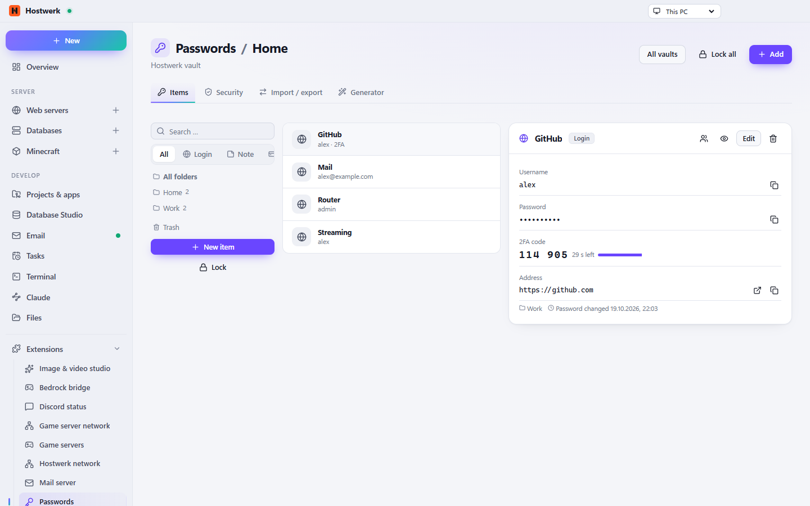

# Password manager

Own encrypted vault on this PC or a connection to the password manager you already use – Bitwarden/Vaultwarden, 1Password, KeePass, pass or LastPass. Everything else (Google, Apple, Proton, Dashlane …) comes in by import.

[Deutsch](README.de.md) · An official [Hostwerk](https://github.com/Passimoritz/hostwerk-public) extension (SDK 2.7, native extension)



## What it does

- Hostwerk vault: AES-256-GCM, key from the master password (scrypt), locks itself after being idle
- Logins, notes, cards and identities with folders, tags, favourites, password history and trash
- 2FA codes (TOTP), password generator and passphrases
- Security check: weak, reused, old and leaked passwords (Have I Been Pwned with k-anonymity) and important services without 2FA – also as a dashboard tile “Password check”
- Import from 18 formats, export as Bitwarden JSON, CSV or an encrypted **KeePass file (.kdbx)** with its own password, copy between vaults
- Browser extension for Chrome, Edge, Firefox, Brave, Opera and Vivaldi – pairs itself, suggestions right in the sign-in field
- Share single logins with members (needs “Team & users”), also time-limited
- **Vault service for other extensions**: file share, mail server, router or cloud backup keep their logins in the vault with one call – each extension only ever sees its own entries
- Provider programs (bw, op) are checked every day and updated with a test run

## For other extensions

```js
const vault = await host.use('passwordVault');
vault.status();                                         // { available, vault: { id, name }, locked, readonly }
await vault.save({ source: 'file-share', key: 'sftp:alex', name: 'SFTP alex', username: 'alex', password, url: 'sftp://pc:2222' });
await vault.find({ source: 'file-share', key: 'sftp:alex' });    // without the password
await vault.reveal({ source: 'file-share', key: 'sftp:alex' });  // { username, password } – logged in the change log
```

Saving the same `source` + `key` again updates the entry (the old password stays in its history). A locked vault answers with status 423 and a message to unlock it under Passwords.

## Install

In Hostwerk: **Extensions → Discover** and click “Install”. If you already used this feature in Hostwerk 2.8, the update installs the extension by itself – with all your data.

Native extensions run as part of Hostwerk (own server and interface part). That is why Hostwerk only installs them from the official catalogue (with checksum) or in developer mode.

## Data

`settings.passwords, data/passwoerter/*.hwvault` – exactly where Hostwerk always kept it. Removing the extension deletes nothing.

## Develop

```bash
node --test tests/*.test.js          # tests
node build-native.js .               # build the interface (sdk/build-native.js from hostwerk-public)
node check.js . --strict             # same check as the catalogue (sdk/check.js)
```

Interface source in `ui/src`, server part in `server/`. Texts in the code are English, German is in `locales/de.json`.

## License

MIT
